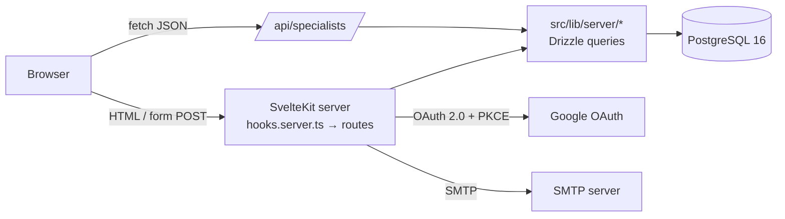
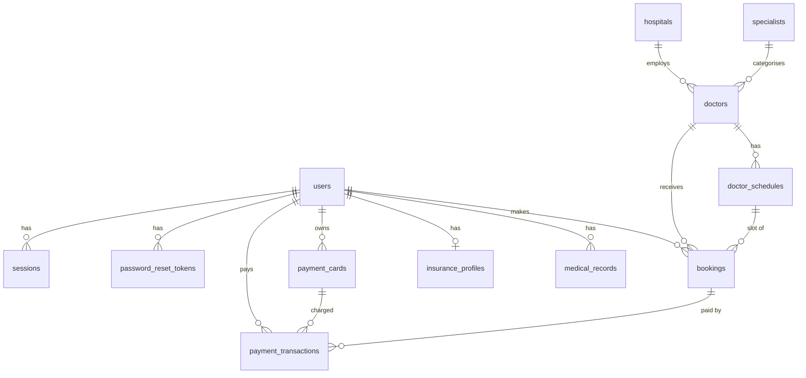

# Architecture

> Part of the [Purwakarta Health docs](./DEVELOPMENT_STATUS.md). Last verified against code: 2026-11-26.

## 1. System overview

Purwakarta Health (repo: `emerald-hospital`) is a single SvelteKit application, server-rendered, backed by one PostgreSQL database. There is no separate backend service: data access happens in SvelteKit `load` functions, form actions, and two `+server.ts` endpoints.



### Surfaces

| Surface | Routes | Audience | Shell |
| ------- | ------ | -------- | ----- |
| Public landing | `/` | Anonymous (logged-in users are redirected) | Standalone page |
| Public doctor finder | `/find-doctor` | Anonymous + authenticated | Standalone page |
| Auth | `/login`, `/login/forgot`, `/login/reset/[token]`, `/login/google/*`, `/register` | Anonymous | Auth pages |
| Patient app | `(patient)` route group: `/home`, `/search`, `/specialists`, `/doctors/[id]`, `/appointments`, `/profile/**` | Patients (some pages public) | Mobile shell + `BottomNav` |
| Manager console | `/manager/**` | Managers | Sidebar (desktop) / drawer (mobile) |

See [PERMISSION.MD](./PERMISSION.MD) for exactly which routes require which role.

## 2. Tech stack

| Layer            | Choice                                                                    |
| ---------------- | ------------------------------------------------------------------------- |
| Framework        | SvelteKit 3.1 (SSR), Svelte 5.57 (runes mode forced in `vite.config.ts`)    |
| Styling          | Tailwind CSS 4 (`@theme` tokens in `src/app.css`)                         |
| Icons            | `@lucide/svelte`                                                          |
| Database         | PostgreSQL 16 (`docker-compose.yml`, image `postgres:16-alpine`)          |
| DB driver        | `postgres` (postgres.js)                                                  |
| ORM / migrations | Drizzle ORM 0.45 + drizzle-kit 0.31                                       |
| Auth             | Custom `sessions` table, Argon2id (`@node-rs/argon2`), `nanoid(32)` IDs   |
| Google OAuth     | Auth-code flow with PKCE, hand-written (`src/lib/server/auth/oauth-google.ts`) |
| Email            | `nodemailer` over SMTP (optional)                                         |
| Client state     | Zustand 5 (search filters + bookmarks only)                               |
| Build            | Vite 8, pnpm 11, TypeScript 6, svelte-check                               |
| Adapter          | `@sveltejs/adapter-auto` 8 (must be replaced before deploy — see [DEPLOYMENT_PLAN.MD](./DEPLOYMENT_PLAN.MD)) |

Security overrides for transitive dependencies live in `pnpm-workspace.yaml`:

```yaml
allowBuilds:
  esbuild: true
overrides:
  esbuild@<0.25.0: '>=0.25.0'   # GHSA-67mh-4wv8-2f99 (dev server)
  cookie@<0.7.0: '^0.7.0'       # GHSA-pxg6-pf52-xh8x (cookie parsing)
```

## 3. Folder structure

```
emerald-hospital/
├─ docs/                           # This documentation set
├─ drizzle/                        # SQL migrations + journal (committed)
│  ├─ 0000_spicy_silver_surfer.sql
│  ├─ 0001_gorgeous_mongu.sql
│  ├─ 0002_glorious_havok.sql
│  ├─ 0003_old_quasimodo.sql
│  ├─ 0004_friendly_madelyne_pryor.sql
│  └─ meta/                        # Drizzle snapshots
├─ scripts/seed.ts                 # `pnpm db:seed` — demo data
├─ src/
│  ├─ app.css                      # Tailwind 4 theme tokens
│  ├─ app.html / app.d.ts          # Document shell, Locals type
│  ├─ env.ts                       # Env var declarations (defineEnvVars) → $app/env/private
│  ├─ hooks.server.ts              # Resolves session cookie → locals.user
│  ├─ lib/
│  │  ├─ assets/                   # favicon.svg, icon_purwakarta_health.png, icon_transparent.svg
│  │  ├─ components/               # Grouped by feature, see UI_COMPONENT.MD
│  │  │  ├─ ui/                    # Shared primitives (Avatar, Dialog, Modal, FormAlert, Pagination, ...)
│  │  │  ├─ layout/                # Header, BackHeader, BottomNav, SearchBar
│  │  │  ├─ auth/ doctor/ specialist/ appointment/ motion/
│  │  │  ├─ profile/               # + insurance/, medical-records/, payment/, settings/
│  │  │  └─ manager/               # + charts/, dashboard/
│  │  ├─ data/                     # Static content: help-support.ts, landing.ts
│  │  ├─ domain/                   # Isomorphic domain constants
│  │  │  ├─ booking-status.ts      # BOOKING_STATUSES, labels, badge classes, chart colours
│  │  │  └─ specialist.ts          # Icon resolver + specialty labels
│  │  ├─ format/                   # Isomorphic formatting
│  │  │  ├─ date.ts                # formatDate(value, preset), toLocalDateString, formatTime12h, DAY_NAMES
│  │  │  ├─ money.ts               # formatCurrency, formatCardNumber
│  │  │  └─ text.ts                # getInitials
│  │  ├─ server/                   # SERVER-ONLY modules (DB, secrets)
│  │  │  ├─ auth/                  # session.ts (sessions, cookie, PublicUser), password.ts, guards.ts,
│  │  │  │                         # redirect.ts, oauth-google.ts, password-reset.ts
│  │  │  ├─ booking/               # booking.ts (slots, createBookingAtomic, cancel), analytics.ts
│  │  │  ├─ catalog/               # catalog.ts (hospitals / specialists / schedules), doctors.ts
│  │  │  ├─ patient/               # users, insurance, medical-records, payments, preferences
│  │  │  ├─ http/                  # forms.ts (formStr, formOpt, readEntityId, withFkGuard),
│  │  │  │                         # list-query.ts (searchWhere, paginate, uuidOrUndefined), pagination.ts
│  │  │  ├─ db/                    # index.ts (client), schema.ts, errors.ts (isUuid, FK/unique checks)
│  │  │  └─ mailer.ts              # SMTP send (logs when unconfigured)
│  │  ├─ stores/                   # search.ts (Zustand), toast.svelte.ts, useZustand.svelte.ts
│  │  └─ utils/                    # Other isomorphic helpers: cn, enhance (toastForm), crud.svelte,
│  │                               # url, appointments, booking-ui, insurance, medical-records, payments
│  ├─ test/                        # Test infrastructure, imported as #test/* (see TESTING.MD)
│  └─ routes/                      # See API.MD for every endpoint/action
├─ static/                         # robots.txt
├─ docker-compose.yml, drizzle.config.ts, vite.config.ts (SvelteKit config lives in the sveltekit() plugin)
└─ package.json, pnpm-lock.yaml, pnpm-workspace.yaml
```

## 4. Layer conventions

- **`src/lib/server/`** is server-only. SvelteKit refuses to bundle it into client code. All DB access and secrets stay here.
- **`src/lib/format/`, `src/lib/domain/`, `src/lib/utils/`, `src/lib/data/`, components** are isomorphic. Use them for types and pure functions shared by `load` and render.
- **Formatting** goes through `lib/format` (`formatDate(value, preset)`, `formatCurrency`, `getInitials`). Booking-status labels, classes and colours, and specialist icons and labels, have a single source in `lib/domain`. Do not re-declare them in components.
- **Auth guards** live in `lib/server/auth/guards.ts`. Loads call `requireUser()` / `requirePatient()` / `requireManager()`; manager form actions call `denyUnlessManager(locals)`.
- **Route handlers** read form input with `formStr` / `formOpt` / `readEntityId` and wrap deletes with `withFkGuard` (`lib/server/http/forms.ts`). Manager list pages use `searchWhere` / `paginate` / `uuidOrUndefined` (`lib/server/http/list-query.ts`).
- **Client data never carries secrets.** Layouts and loads return `PublicUser` (`toPublicUser` / `publicUserOrNull` in `lib/server/auth/session.ts`), which omits `passwordHash` and `googleId`.
- **Each route owns its data** through `+page.server.ts` (`load` + `actions`). Components are props consumers.
- **Mutations use form actions** (`<form method="POST" action="?/x" use:enhance>`). JSON endpoints exist only where needed: specialty autocomplete and CSV export.
- **Feedback after actions** is shown through the `toastForm` helper (`src/lib/utils/enhance.ts`) and the global `Toaster`.
- New server modules should follow the existing pattern: pure async functions over Drizzle with explicit return types.

## 5. Data model

Schema: `src/lib/server/db/schema.ts`. Migrations: `drizzle/`.



### Enums

| Enum | Values |
| ---- | ------ |
| `user_role` | `manager`, `patient` |
| `booking_status` | `pending`, `confirmed`, `cancelled`, `completed` |
| `gender` | `male`, `female`, `other` |
| `card_brand` | `visa`, `mastercard` |
| `insurance_status` | `ACTIVE`, `INACTIVE` |
| `medical_record_type` | `lab`, `imaging`, `clinical` |

### Tables

| Table | Purpose | Notable columns |
| ----- | ------- | --------------- |
| `users` | Patient + manager accounts | `password_hash` (nullable for Google-only), `google_id` (unique), `email_verified`, `role`, `blood_type`, `date_of_birth`, `gender`, `address` |
| `sessions` | One row per logged-in browser | `id` (nanoid 32), `expires_at` (30 days) |
| `password_reset_tokens` | Forgot-password links | `token_hash` (SHA-256, unique), `expires_at` (1 h), `used_at` |
| `hospitals` | Partner facilities | `image_url`, `contact` |
| `specialists` | Specialty categories | `slug` (unique), `icon` |
| `doctors` | Doctor profiles | `consultation_fee` (numeric), `rating`, `review_count`, `bio`, `is_active`, `is_online` |
| `doctor_schedules` | Weekly availability | `day_of_week` (0 = Sunday), `start_time`, `end_time`, `max_quota` (per 30-min slot) |
| `bookings` | Appointments | `status`; index on `(schedule_id, appointment_date, appointment_time, status)` |
| `payment_cards` | Saved cards — last4 only, no PCI data | `brand`, `last4`, `expires`, `is_default` |
| `payment_transactions` | Payment history | `amount`, `currency`, `paid_at`, `card_id`, `booking_id` |
| `insurance_profiles` | One per patient (unique `user_id`) | `cost_pcp`, `cost_specialist`, `cost_emergency`, `cost_rx`, `coverage_start/end`, `status` |
| `medical_records` | Lab / imaging / clinical notes | `type`, `file_url`, `notes` |

### Migrations

| # | File | Change |
| - | ---- | ------ |
| 0 | `0000_spicy_silver_surfer.sql` | Baseline: users, sessions, hospitals, specialists, doctors, schedules, bookings |
| 1 | `0001_gorgeous_mongu.sql` | Payment, insurance, medical tables; extra user/doctor columns; booking indexes |
| 2 | `0002_glorious_havok.sql` | Nullable `users.password_hash`; `google_id`, `email_verified` |
| 3 | `0003_old_quasimodo.sql` | `password_reset_tokens` |
| 4 | `0004_friendly_madelyne_pryor.sql` | 8 indexes on foreign keys used in joins and filters |

Always use `pnpm db:generate` + `pnpm db:migrate` so a migration file is committed. `pnpm db:push` is for throwaway prototyping only.

## 6. Key design decisions

### 6.1 Session-based auth

- Sessions are 30-day opaque IDs in the `sessions` table, sent as the HttpOnly cookie `session_id` (`SameSite=Lax`, `Secure` when `NODE_ENV=production`).
- `hooks.server.ts` validates the cookie on **every** request with a single joined query (`validateSession`) and sets `locals.user` (full `users` row, server-side only) or `null`. Expired sessions are deleted lazily on first use.
- Passwords are hashed with Argon2id (`memoryCost 19456`, `timeCost 2`, `parallelism 1`).

### 6.2 Google OAuth (PKCE)

- `state` + PKCE verifier are stored in HttpOnly cookies scoped to `/login/google`, 10-minute TTL.
- Auto-link to an existing local account only when Google reports `email_verified: true`; otherwise the sign-in is refused. This blocks account takeover via an attacker-controlled Google account.
- Managers always land on `/manager`; patients go to the saved `redirect` cookie or `/home`.

### 6.3 Race-safe booking

`createBookingAtomic` (`src/lib/server/booking/booking.ts`) runs in a transaction, locks the `doctor_schedules` row with `SELECT … FOR UPDATE`, re-counts non-cancelled bookings for that slot, and inserts only if quota remains. **Never revert to a non-transactional check-then-insert** — it allowed double-booking.

Slots are 30-minute increments from `start_time` to `end_time`. Each slot's capacity is `max_quota` minus non-cancelled bookings.

### 6.4 Password reset

- A random 32-byte token is emailed; only its SHA-256 hash is stored.
- Single-use (`used_at`, consumed atomically so a token cannot be reused by a racing request), 1-hour TTL; requesting a new link deletes older unused tokens.
- `/login/forgot` always reports success to prevent email enumeration.
- A successful reset deletes all sessions for that user.

### 6.5 Analytics and charts

- All aggregations are in `src/lib/server/booking/analytics.ts` and share one `AnalyticsFilters` type (range `7d | 30d | 90d | 365d | all`, hospital, specialty). The CSV export reuses the same filters, so the export matches the dashboard.
- Charts are pure SVG components (`src/lib/components/manager/charts/`). No chart library.

### 6.6 Client state

Zustand is used **only** for search filters and bookmarks, through the `useZustand.svelte.ts` runes wrapper. It persists to `localStorage` key `emerald-search` (kept after the rebrand to preserve existing data). Everything else comes from SvelteKit page data.

### 6.7 Preferences

Push/email/language preferences are stored in non-HttpOnly cookies (1-year TTL), not in the database. They don't follow the user across devices and don't trigger any behaviour yet.

### 6.8 Branding

- Assets: `src/lib/assets/icon_purwakarta_health.png` (header), `favicon.svg` (tab).
- Brand strings are inline in `layout/Header.svelte`, `login/+page.svelte`, `register/+page.svelte`, and `LANDING_BRAND` in `src/lib/data/landing.ts`.
- The CSV export header/filename, seed emails (`@emerald.com`), and the Zustand storage key still use "Emerald".
