# Deployment Plan

> Part of the [Purwakarta Health docs](./DEVELOPMENT_STATUS.md). Last verified against code: 2026-11-26.

**Status:** not deployed. No adapter selected, no CI/CD, no production environment.

## 1. Go-live blockers

Do these before exposing the app to real users.

| # | Blocker | Reference |
| - | ------- | --------- |
| ~~B1~~ | ~~Add role checks to every manager form action~~ — **done 2026-10-22** | [PERMISSION.MD](./PERMISSION.MD), R1 |
| B2 | Replace `adapter-auto` with an explicit adapter | §2 |
| B3 | CI pipeline running `check` + `build` + `audit` (+ tests once written) | §4 |
| B4 | Production Postgres with backups | §3 |
| B5 | Rate limiting on `/login`, `/register`, `/login/forgot` (proxy or app) | R3 |
| B6 | HTML-escape user data in the reset email | R4 |
| B7 | Error tracking (Sentry or similar) | TD-10 |

## 2. Target platform options

| Option | Adapter | Fit |
| ------ | ------- | --- |
| **A. Node on a VM / container (recommended)** | `@sveltejs/adapter-node` | Simplest with long-lived Postgres connections (`postgres` driver) and `@node-rs/argon2` native binary. Run behind Nginx / Caddy for TLS and rate limiting. |
| B. Vercel | `@sveltejs/adapter-vercel` (Node runtime) | Works. Needs a pooled Postgres (Neon, Supabase pooler) because serverless opens many connections. Argon2 native binary must match the runtime. |
| C. Cloudflare | `@sveltejs/adapter-cloudflare` | ❌ Not suitable without changes: `@node-rs/argon2`, `nodemailer`, and `node:crypto` need Node APIs. |

Switch for option A:

```bash
pnpm remove @sveltejs/adapter-auto
pnpm add -D @sveltejs/adapter-node
```

```ts
// vite.config.ts — SvelteKit 3 has no svelte.config.js; options go to the sveltekit() plugin
import adapter from '@sveltejs/adapter-node';
```

Run with `node build` (env: `PORT`, `HOST`, `ORIGIN=https://<domain>`). `ORIGIN` is required so SvelteKit's CSRF check and `url.origin` (used in reset links and the OAuth redirect URI) are correct behind a proxy.

## 3. Environments

| Env | Purpose | Database | Data |
| --- | ------- | -------- | ---- |
| local | Development | Docker `postgres:16-alpine` | `pnpm db:seed` |
| staging | QA / demo | Managed Postgres 16 | Seed or anonymised copy |
| production | Real users | Managed Postgres 16, daily backups + PITR | Real. **Never run `db:seed`** — it wipes data. |

### Configuration per environment

| Variable | local | staging / production |
| -------- | ----- | -------------------- |
| `DATABASE_URL` | Docker DB | Secret manager |
| `NODE_ENV` | `development` | `production` (enables `Secure` cookies) |
| `ORIGIN` | — | `https://<domain>` (adapter-node) |
| `GOOGLE_CLIENT_ID` / `SECRET` | optional | Separate OAuth client per env. Register `https://<domain>/login/google/callback`. |
| `SMTP_*` | empty (console) | Real SMTP / transactional provider. Set SPF/DKIM for `SMTP_FROM`. |

Never commit `.env`. It is gitignored. `.env.example` is the template.

## 4. CI/CD pipeline (proposed)

```mermaid
flowchart LR
  PR[Merge request] --> CI[install --frozen-lockfile<br/>check · test · build · audit]
  CI -->|merge to master| Img[Build artifact / Docker image]
  Img --> Mig[pnpm db:migrate on staging]
  Mig --> Stg[Deploy staging + smoke test]
  Stg -->|manual approval| PMig[db:migrate on production]
  PMig --> Prod[Deploy production]
  Prod --> Mon[Health check + error monitoring]
```



Rules:

- The pipeline fails if `pnpm check`, tests, or `pnpm build` fail.
- Migrations run **before** the new code goes live and must be backward compatible with the old code (add a column → deploy → backfill → remove later).
- Production deploy needs a manual approval.

## 5. Release steps

1. Confirm the blockers in §1 are closed.
2. Tag the release on `master`.
3. Back up the production DB (snapshot).
4. `pnpm db:migrate` against production. Stop if it fails.
   - Migration `drizzle/0004_*.sql` creates 8 foreign-key indexes with plain `CREATE INDEX`. That takes a brief write lock per table, which is fine at current table sizes. If the tables have grown large, create the indexes manually with `CREATE INDEX CONCURRENTLY` first (outside a transaction) and then run the migration.
5. Deploy the new build. Restart the Node process or roll the containers.
6. Smoke test: `/` loads, login as a test patient, open `/manager` as a test manager, run one booking on a test doctor.
7. Watch error logs for 30 minutes.

## 6. Rollback

| Situation | Action |
| --------- | ------ |
| App bug, no schema change | Redeploy the previous build / image. |
| App bug after an additive migration | Redeploy the previous build. The extra column/table is harmless. |
| Destructive migration went wrong | Restore the snapshot from step 3. Expect data loss since the snapshot, so avoid destructive migrations in the same release as code changes. |

Drizzle has no automatic down migrations. Write a manual SQL revert script for any risky migration before running it.

## 7. Operational checklist

- [ ] TLS terminated at the proxy. HTTP → HTTPS redirect.
- [ ] Rate limits on auth endpoints (for example, Nginx `limit_req` 5 r/m per IP on `/login`, `/register`, `/login/forgot`).
- [ ] Security headers (CSP, `X-Frame-Options`, `Referrer-Policy`) via proxy or `hooks.server.ts`.
- [ ] Scheduled cleanup of expired `sessions` and `password_reset_tokens` rows (cron SQL).
- [ ] DB backups verified by a test restore.
- [ ] Error monitoring + uptime check on `/`.
- [x] `logs/` removed from git and added to `.gitignore` (8782637).
