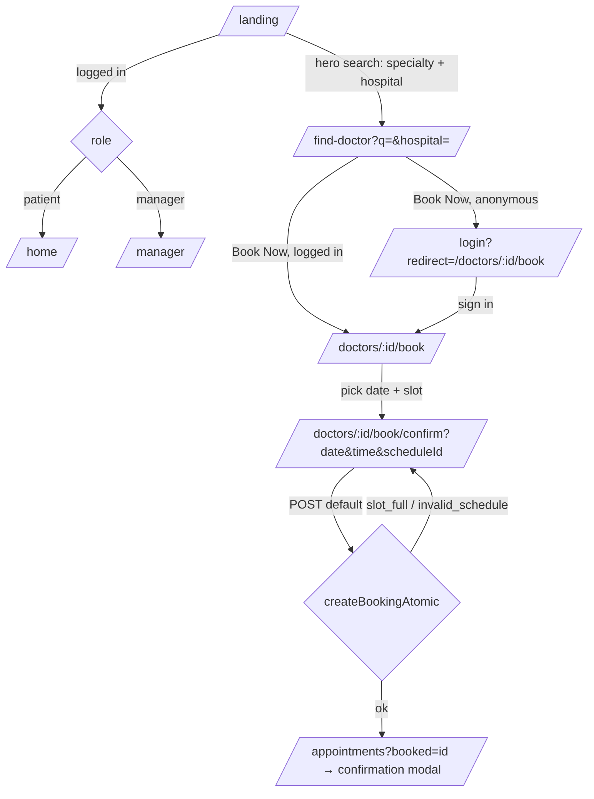
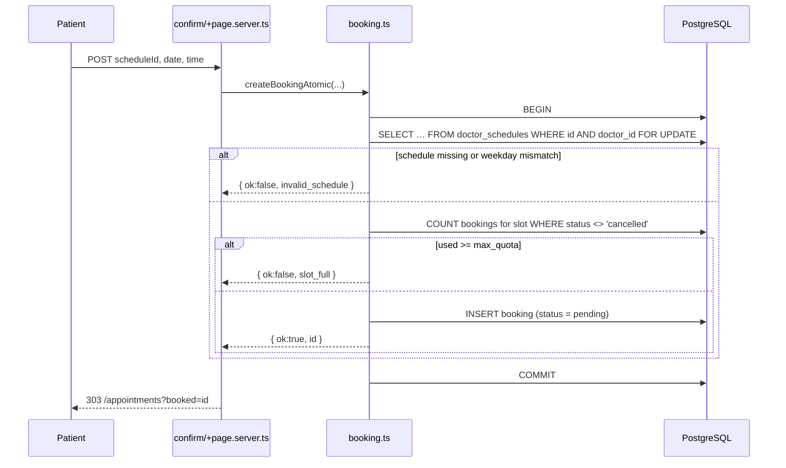
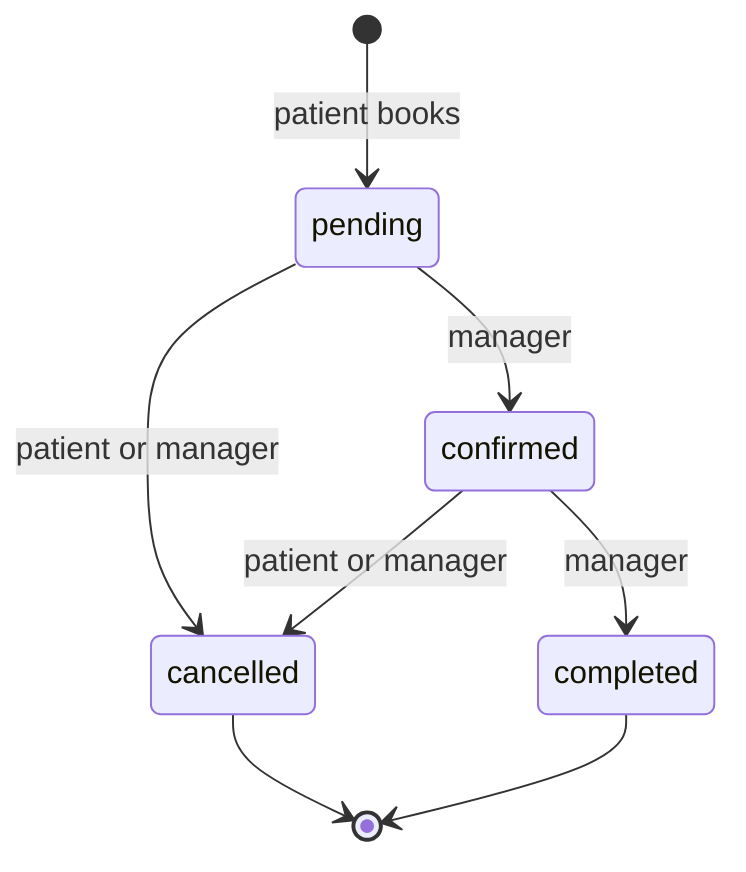
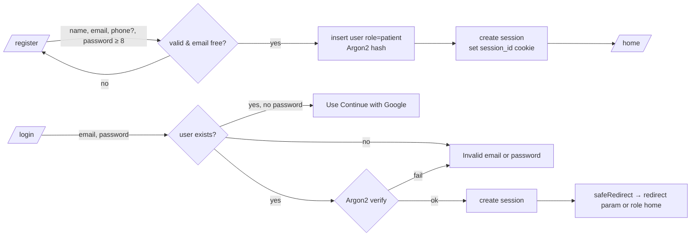
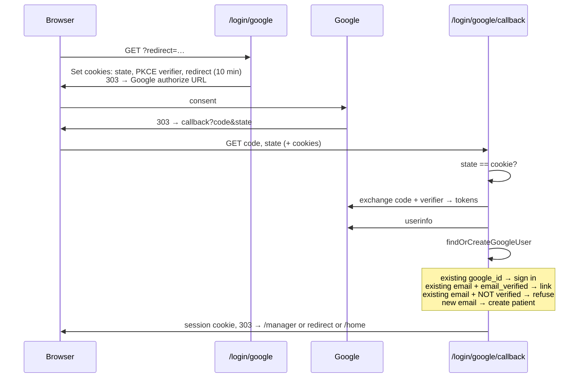
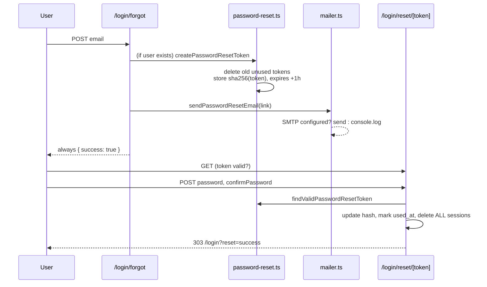
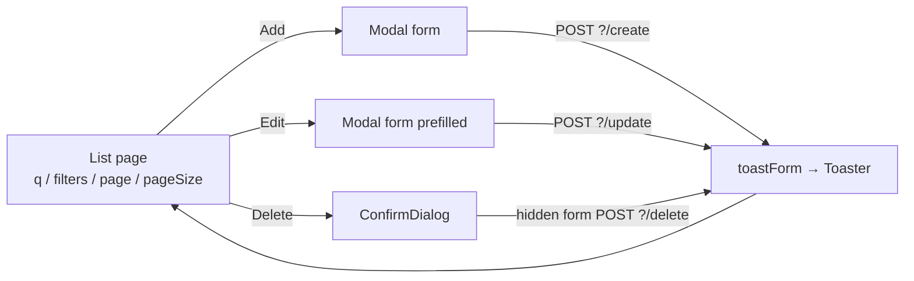

# User & System Flows

> Part of the [Purwakarta Health docs](./DEVELOPMENT_STATUS.md). Last verified against code: 2026-10-22.

Diagrams use Mermaid and render on GitHub, GitLab, and VS Code's Markdown preview.

## 1. Anonymous search → booking

- The specialty input calls `GET /api/specialists?q=` with a 250 ms debounce. Stale responses are dropped through a request counter.
- `/doctors/[id]/book` is viewable without login. The login redirect happens on the confirm **POST**, which preserves the full confirm URL in `?redirect=`.

## 2. Booking transaction

## 3. Booking lifecycle

- Patients can cancel only `pending` or `confirmed` bookings (`cancelBookingForUser`).
- Managers can set **any** status from any status. There is no transition validation. See [TECHDEBT.MD](./TECHDEBT.MD).
- Cancelled bookings free the slot immediately (availability counts ignore `cancelled`).

## 4. Registration and email login

## 5. Google sign-in (OAuth 2.0 + PKCE)

## 6. Forgot / reset password

## 7. Logout

Patients use `/profile?/logout` or `/profile/settings?/logout`. The manager layout posts to `/profile?/logout`. The action deletes the session row and clears the cookie, then `303 /login`.

## 8. Manager CRUD

The same pattern applies to hospitals, specialists, doctors, and schedules. Bookings have only an inline status `<select>` posting `?/updateStatus`.

### Delete and foreign keys

| Delete | FK behaviour | Result today |
| ------ | ------------ | ------------ |
| Hospital with doctors | `doctors.hospital_id` → no action | `409` "Hospital still has doctors…" |
| Specialist with doctors | `doctors.specialist_id` → no action | `409` |
| Doctor with bookings | `bookings.doctor_id` / `schedule_id` → no action (schedules cascade, but bookings block it) | `409` — mark the doctor inactive instead |
| Doctor without bookings | schedules `ON DELETE CASCADE` | OK |
| Schedule with bookings | `bookings.schedule_id` → no action | `409` |

Delete actions catch the Postgres FK violation (SQLSTATE `23503`, via `isForeignKeyViolation` in `src/lib/server/db-errors.ts`) and return `fail(409, { error })`. Fixed 2026-10-22 (TD-04).

## 9. Manager dashboard and CSV export

1. `/manager?range=&hospitalId=&specialistId=` — a GET form, so filters live in the URL.
2. The `load` function calls `totals`, `previousTotals` (for trend chips; hidden when `range=all`), `bookingsOverTime`, `statusBreakdown`, `bookingsBySpecialty`, `topDoctors`, and `recentBookings`.
3. **Export** links to `/manager/export.csv` with the same query string → `exportRows(filters)` → CSV download.
